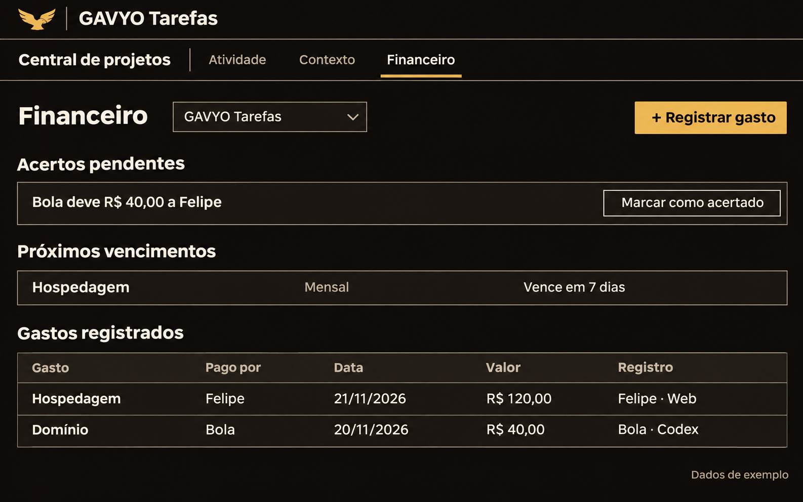

# GT-1 · Financeiro da Central de projetos

Proposta para Bola e Felipe revisarem antes da implementação.

## Como dividir os gastos

**Recomendação:** quem registra escolhe os participantes de cada gasto. O sistema divide o valor igualmente entre eles e indica quanto cada participante deve a quem pagou. Se quem pagou também participou, a própria parte já está coberta. Pagamentos em direções opostas se compensam entre as mesmas duas pessoas, dentro do projeto.

Exemplo com dados fictícios: Felipe paga R$ 120,00 de hospedagem, divididos entre ele e Bola. Bola paga R$ 40,00 de domínio para os mesmos dois. O resumo mostra que Bola deve R$ 40,00 a Felipe. O botão **Marcar como acertado** confirma esse valor e guarda o registro. Uma despesa posterior gera um novo saldo.

**Alternativa:** configurar um grupo fixo de sócios por projeto e dividir sempre entre eles. O cadastro fica mais rápido, mas despesas que envolvem só parte do grupo exigem exceções. Outra opção é definir valores personalizados por pessoa. Ela atende participações desiguais e torna o lançamento mais longo.

## Tela e lembretes

Na aba Financeiro, o projeto selecionado aparece no topo, ao lado de **Registrar gasto**. Abaixo ficam **Acertos pendentes**, **Próximos vencimentos** e **Gastos registrados**, nessa ordem. A primeira seção mostra quem deve, a quem e quanto. A lista de gastos mostra descrição, valor, quem pagou, data e autoria. No celular, as seções ficam em uma coluna. A tela mantém a Manrope, o dourado e os fundos do app, com cantos retos e botões de 34 px no desktop e 44 px no toque.

O lançamento guarda descrição, valor em reais, data, projeto, quem pagou e participantes. Para mensal ou anual, o sistema calcula o próximo vencimento. A proposta é mostrar um aviso na aba sete dias antes, sinalizar atrasos e só incluir a próxima parcela no acerto quando alguém confirmar o pagamento. Datas no fim do mês usam o último dia válido sem perder a referência original.

## Regras de implementação e aceite

- Valores em centavos. Quando a divisão deixa centavos restantes, a distribuição segue uma ordem estável, e a soma das partes bate com o valor pago.
- Todo gasto e acerto guarda quem registrou, canal Web/Codex/Claude e hora no servidor. Um acerto preserva seu valor e o histórico. Se o saldo mudar antes da confirmação, a tela recarrega o valor e pede nova confirmação.
- Web e MCP usam as mesmas regras de registro e leitura. O MCP oferece operações para registrar um gasto e consultar o resumo por projeto.
- A tabela nova funciona em SQLite e MySQL. A aba usa o padrão da Central e o CSS existente. O PR inclui testes do rateio, dos centavos, do acerto repetido, das recorrências e da autoria.
- Validar `npm test` e conferir os fluxos em desktop e celular antes de abrir PR. A revisão segue em branch separada, pois a `main` publica o site.

**Decisão para fechar com Felipe:** o rateio fica por gasto, com participantes selecionados e partes iguais, ou o projeto terá um grupo fixo de sócios?
